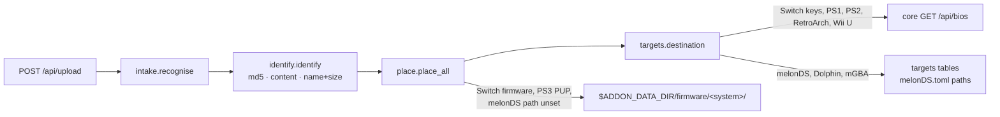

# 7 — bios-manager (:8773, `/bios`)

Takes BIOS dumps, firmware and keys from a browser and files each one where
the emulator GameCore runs for that system reads it. User-facing behaviour,
the per-system table and the safety list: [`addons/bios-manager/README.md`](../../addons/bios-manager/README.md).

## Modules

| File | Job |
|---|---|
| `server.py` | routes, upload size cap, one upload at a time, temp files under `$ADDON_DATA_DIR/tmp` |
| `intake.py` | `recognise()`: loose files and zips (nested, 3 levels) into recognised items; zip budget |
| `identify.py` | `identify()`: md5 table, then content, then name and size. Pure |
| `known_bios.json` | md5 to system and target names; generated by `tools/build_known.py` from libretro `System.dat` |
| `targets.py` | the roots, `systems()` (installed systems), `core_rows()` (core `GET /api/bios`), `destination()` |
| `place.py` | `place_all()`: write with backup, stage firmware, report one `outcome` per file |
| `status.py` | `report()`: per installed system, files present or missing and staged items |

## The flow

## Where a file goes

- **The core owns the directory when a pack declares a `bios` block.** It has
  expanded `@FLATPAK_CONFIG@` for the Flatpak installed, and its launch gate
  checks the same path. Re-deriving it in the addon would be a second answer
  that drifts. When the core does not answer, those files are not placed.
- **The addon owns the rest**, as facts about the emulator: melonDS's
  configured paths (`[DS]` / `[DSi]` in `melonDS.toml`, read with `tomllib`,
  never written), Dolphin's `GC/<region>/IPL.bin`, mGBA's
  `<config>/gba_bios.bin` fallback. Flatpak or native follows
  `systems.json` `path`.
- **Names come from the table or the rules, never from the upload**, except
  for DuckStation and PCSX2 BIOS files, which keep their bare file name: both
  emulators list their folder.

## Why firmware is staged, not installed

Ryujinx's firmware is `bis/system/Contents/registered/<id>.nca/00`, written by
Ryujinx after it checks the NCAs against the keys; RPCS3 decrypts the PUP into
`dev_flash`. Copying files would fake an install the emulator never verified.
Both have a CLI (`--install-firmware`, `--installfw`), but both open a window,
so the addon shows the command instead of running it on the TV.

## Traps

- **`dc/naomi.zip` is a BIOS, not an archive to open.** `recognise()` only
  opens a zip that is not itself a known file (md5 or a name the core
  declares).
- **A PS1 and a PS2 BIOS both contain "Sony Computer Entertainment Inc".**
  Size tells them apart (512 KB, 4 MB).
- **PCSX2 is pinned to `ps2-0150e-20001228.bin`** by GameCore's seed. Another
  PS2 BIOS is stored beside it and the report says so; the addon never edits
  emulator configs.
- **The DSi NAND is a save container.** `place.NEVER_REPLACE` keeps an
  existing one, whatever the upload.
- **`/tmp` is RAM on the box.** Multipart spill files and the work directory
  live under `$ADDON_DATA_DIR/tmp`.
- **Azahar 2125 reads no `aes_keys.txt`**: one uploaded is reported as
  ignored with that reason.
